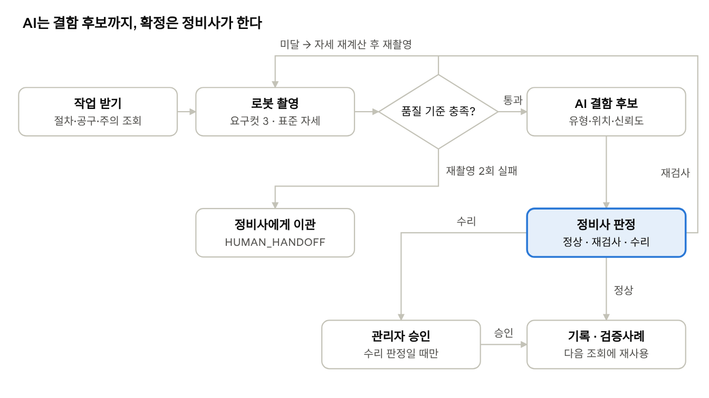
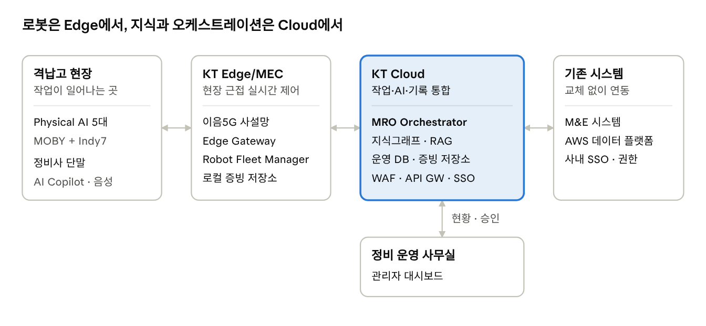
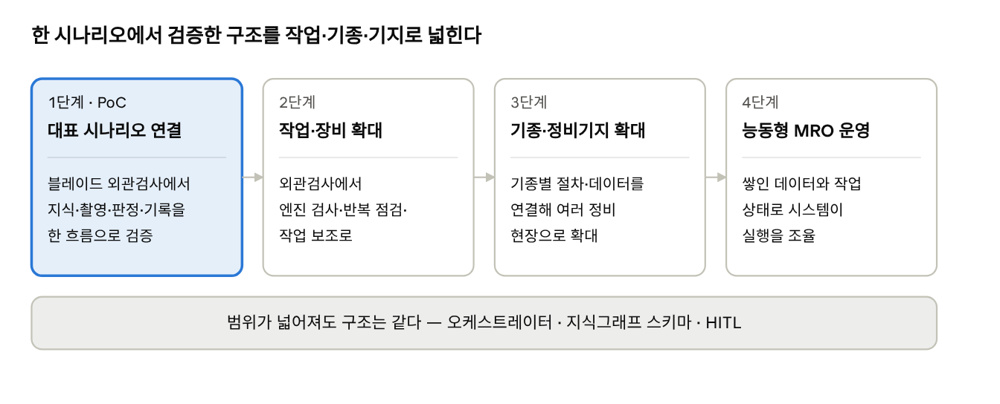

# Physical AI 기반 항공정비 작업 실행·운영 체계 (AERON)

> **데모 바로 보기: https://aeron-vadw.onrender.com**
> 로그인 화면에서 정비사나 관리자를 골라 바로 들어가면 됩니다(시연용 계정이 채워져 있음).
> 무료 서버라 한동안 접속이 없으면 잠들어, 첫 접속에 1분쯤 걸릴 수 있습니다. 직접 실행하는 방법은 [아래](#실행-방법)에 있습니다.

## 한눈에 보기

AERON은 정비 지식·AI·로봇·기존 시스템을 하나로 이어, 작업 지시부터 기록까지를 관리하는 항공정비 작업 실행 운영체계다. 정비사가 판정하고, AI와 로봇은 찾기·촬영·기록 같은 주변 공수를 맡는다.

| 항목 | 내용 |
| --- | --- |
| 고객 | 대한항공 엔진 정비 부문 (정비사, 감독자·작업관리자) |
| 제안 | KT(통합·AI·Cloud·Edge) + 뉴로메카(협동로봇·Physical AI) 컨소시엄 |
| 해결할 문제 | 정비 물량은 늘고 인력은 줄며, 정비사 시간의 65~75%가 탐색·대기·기록에 쓰인다 |
| 핵심 가치 | 흩어진 판단 근거를 한 작업 흐름 위로 모으고, 결과를 검증된 지식으로 쌓는다 |
| 대표 시나리오 | 엔진 오버홀 중 분해된 HPC 블레이드 외관검사 |
| 서비스 | 정비사 AI Copilot · 관리자 대시보드 · Physical AI 작업 지원 · MRO Execution Orchestrator |
| 원칙 | Human-in-the-Loop: AI는 결함 후보까지만, 확정은 정비사, 수리 판정은 관리자 승인 |
| 목표 KPI | 비부가가치 공수 20%↓, 검색시간 40%↓, 증빙 자동 연결률 95%↑, 작업지식 완결률 90%↑ |

## 1. 문제 정의

대한항공 엔진 정비는 2030년까지 물량이 4배 이상 늘지만, 현장 정비사는 줄고 있고 그 시간의 대부분은 정비가 아닌 탐색·대기·기록에 쓰인다. 문제는 기술이 아니라 지식·사람·장비·시스템을 잇는 연결이 여전히 사람에게 의존한다는 점이다.

### 1-1. 수요는 늘고 여력은 줄어든다

| 지표 | 현재 → 목표·추이 | 출처 |
| --- | --- | --- |
| 엔진 정비 물량 | 연 116대 → 500대 (2030) | 대한항공 뉴스룸·헤럴드경제 (2026) |
| 정비 기종 | 6종 → 12종 | 같은 출처 |
| 엔진 정비 매출 | 약 1조3,000억 원 → 5조 원 이상 (2030) | 같은 출처 |
| 외부 고객 비중 | 약 24% → 60% (2030) | 같은 출처 |
| 국내 항공 정비사 | 5,940명(2019) → 5,330명(2022), 8.4% 감소 | 국토교통부 에어포탈 |
| 국내 MRO 시장 | 0.7조 → 5조 원 목표, 약 7배 | 항공정비산업 경쟁력 강화방안 (2021) |
| 실제 작업 시간 | 전체의 25~35%, 나머지 65~75%는 비작업 | Reliableplant, Wrench Time |

2026년 12월 아시아나항공 통합과 2027년 운북지구 신엔진정비공장 가동으로 정비 대상과 운영 복잡성이 함께 커진다. 신공장만 보면 연간 처리 대수는 100대 → 360대, 기종은 6종 → 9종이다.

### 1-2. 현장에서 보이는 문제

현직 신입 정비사 인터뷰에서 세 가지가 반복됐다.

1. **정보를 찾는 데 시간이 간다.** 작업 직전에 배정돼 매뉴얼을 충분히 찾기 어렵고, 가장 빠른 방법은 선배에게 물어보는 것이다.
2. **지시와 상태 전달이 사람을 거친다.** 관리자·감독자 지시가 전달 중에 누락되거나, 승인을 기약 없이 기다리는 일이 잦다.
3. **노하우가 개인 기록에 머문다.** 반복 작업은 사진을 찍어 개인 PPT 매뉴얼로 만들고, 정비일지는 제출 후 다시 쓰이지 않는다.

### 1-3. 왜 엔진 블레이드 검사인가

엔진 오버홀 물량이 늘면 블레이드 외관검사처럼 같은 조건으로 반복해야 하는 검사와 판단이 함께 늘어난다. 검사·판정·기록·후속조치의 연결 부담이 정비사 한 사람에게 몰린다. 대한항공은 이미 기체 외관에 드론·로버 검사(8~10시간 → 약 50분)와 예지정비를 도입했지만, 검사 결과가 작업지시·교범·판정·기록과 하나로 이어지는 층은 비어 있다.

루프트한자 테크닉도 로봇 검사를 도입하며 같은 지점에서 막혔다. 기성 솔루션이 없었고, 제조사마다 언어가 달라 미들웨어를 직접 만들어야 했으며, IT를 포함한 전체 프로세스에 연결돼야 효율이 났다(MRO-Network, 2019). 필요한 것은 로봇 한 대가 아니라 로봇·AI·IT를 잇는 **연결 층**이다.

## 2. 목표와 고객

목표는 정비사의 검사·판단 자체를 줄이는 것이 아니라, 그 전후의 탐색·반복 촬영·증빙 정리·중복 기록 공수를 줄여 정비사가 전문 판단에 집중하게 하는 것이다.

### 2-1. 고객과 이해관계자

| 대상 | 지금 겪는 불편 | AERON이 주는 것 |
| --- | --- | --- |
| 정비사 (현장) | 교범·이력·사례를 여러 곳에서 찾고, 촬영·기록을 반복한다 | 작업 맥락에 맞는 절차·공구·주의·사례, 로봇 촬영, 자동 기록 |
| 신입 정비사 | 처음 보는 결함을 판단할 근거가 선배의 기억에 있다 | 검증된 과거 사례와 현장 질의 챗봇 |
| 감독자·작업관리자 | 누가 어디서 막혔는지 사람에게 물어야 안다 | 실시간 가동보드, 승인 대기큐, 근거 있는 운영 제안 |
| 정비 조직 (대한항공) | 통합·증설로 늘어난 물량을 같은 품질로 처리해야 한다 | 기존 M&E·ERP·AWS를 바꾸지 않고 연동하는 실행 기반, 축적되는 지식 |

### 2-2. 제안 전략 3가지

- **CONNECT** — 정비 지식·사람·AI·로봇·시스템을 연결한다. 전면 교체가 아니라 기존 자산과 연동한다.
- **ORCHESTRATION** — 지시 → 실행 → 판단 → 기록을 한 흐름으로 관리한다. 판단은 사람, 실행 보조는 AI·로봇이 맡는다(HITL).
- **EXPAND** — 한 시나리오에서 검증한 구조를 다른 작업·기종·정비기지로 넓힌다.

### 2-3. PoC 범위

- **포함:** 엔진 오버홀 중 분해된 HPC 블레이드 3장의 순차 외관검사(ATA 72). 확장 검증으로 동체 외판 육안검사(ATA 53).
- **제외:** 실제 부품 상태 검사, 손상 해석, 정비사의 최종 판정(Repair·Accept), 분해·조립·수리, 규정상 검사·승인. 이 업무는 사람이 하고 효과 산정에서도 빠진다.

## 3. 서비스 구성

AERON은 사람이 쓰는 화면 두 개, 현장에서 움직이는 로봇 하나, 이 셋을 묶는 오케스트레이터로 구성된다. 모든 화면은 같은 지식그래프를 읽고 쓴다.

| 구성 | 사용자 | 하는 일 |
| --- | --- | --- |
| 정비사 AI Copilot | 정비사 | 긴급도순 작업 큐, 로봇 촬영 요청, AI 결함 후보와 신뢰도, 교범 절차·공구·주의사항, 과거 사례, 판정 입력, 현장 질의 챗봇 |
| 관리자·감독자 대시보드 | 감독자·작업관리자 | 전체·완료·대기·긴급 집계, 정비사·로봇 가동보드, 수리 판정 승인 대기큐, 병목 감지와 근거 있는 제안, 품질·인재·지식 탭 |
| Physical AI 작업 지원 | 로봇(MOBY + Indy7) | 작업자 구역을 피해 접근, 표준 자세로 촬영, 품질 자체 검사, 미달 시 자세 재계산 후 재촬영 |
| MRO Execution Orchestrator | 시스템 | 배정 → 준비 → 실행 → 판단 → 승인 → 기록의 상태 관리, 로봇 작업 전달, 예외 처리, 자동 기록·연계 |

### 3-1. 정비사 화면의 단계

1. **작업 받기** — 긴급 > 주의 > 정상 순으로 정렬된 큐에서 원클릭 시작. 긴급 작업이 생기면 순서가 바뀐다.
2. **로봇 촬영** — 요구컷(리딩엣지·압력면·흡입면)을 로봇에 맡기거나 직접 촬영한다.
3. **AI 결과** — 결함 유형·위치·신뢰도, 준비할 공구, 조치 순서, 판단 근거가 된 과거 사례를 한 화면에 보여준다.
4. **판정** — 정비사가 정상·재검사·수리 중 하나를 고른다. 수리는 관리자 승인 대기로 간다.
5. **기록** — 사진·판정·조치가 작업지시에 자동으로 연결되고 관리자 현황판에 반영된다.

챗봇은 "BLADE 검사 절차에 대해서 알려줘", "균열이 발견되면 어디까지 검사해야 하고, 추가 검사가 필요한 경우는 언제야?", "같은 부위에 균열이 발생했던 과거 정비 사례 볼 수 있어?" 같은 현장 질문에 지식그래프 근거로 답한다.

### 3-2. 관리자 대시보드의 네 영역

| 영역 | 보는 것 | 판단하는 것 |
| --- | --- | --- |
| 운영 | 작업 현황, 정비사·로봇 가동, 승인 대기·예외 | 지금 어디가 막혔고 무엇부터 대응할지 |
| 품질 | 재검사·재촬영, 반려 사유, 증빙 누락, 반복 결함 | 반복 문제와 기록 누락을 일찍 찾기 |
| 인재 | 숙련도별 부하, 신입 지원 필요, 팀별 재작업 | 과부하·지원 필요 구간 |
| 지식 | 검증사례, 사진→판정→조치→작업지시 연결 완결성 4체크 | 작업 결과가 조직 지식으로 쌓이는지 |

AI는 근거를 붙인 제안까지만 하고, 배정·실행 결정은 관리자가 한다.

## 4. 대표 시나리오 — HPC 블레이드 외관검사

분해된 HPC 블레이드 3장을 로봇이 순서대로 촬영하고, AI가 결함 후보를 표시하면 정비사가 판정한다. 정상 흐름보다 예외 처리(재촬영·사람 이관·재검사)가 단순 자동화와 다른 점이다.



로봇 촬영이 기준에 못 미치면 자세를 다시 계산해 찍고, 2회 실패하면 그 작업만 사람에게 넘긴다. 정비사가 재검사를 고르면 촬영 단계로 돌아가고, 수리를 고르면 관리자 승인을 거쳐 기록된다.

### 4-1. 판단 규칙

| 판단 | 무엇을 정하는가 | 실행 위치 |
| --- | --- | --- |
| ⓪ 분해 | 작업지시를 절차 지식으로 풀어 단계 목록을 만든다 | Cloud |
| ① 실행 게이트 | 어떻게 찍을지 계획하고, 로봇이 지금 할 수 있는지 확인한다 | 계획 Cloud · 검증 Edge |
| ② 촬영 검증 | 사진이 기준에 못 미치면 조건을 바꿔 다시 찍는다 | 루프 Edge · 확정 Cloud |
| ③ 수동 전환 | 로봇이 멈추면 그 작업만 사람에게 넘긴다 | 정지 Edge · 결정 Cloud |
| ④ 전이 | 정비사 판정에 따라 다음 단계·재검사·기록을 가른다 | Cloud |
| ⑤ 종료 | 증빙 누락을 확인하고 Work Card를 닫는다 | Cloud |

PoC에서는 ⓪~④과 수리 승인까지 구현하고, ⑤의 완결성 게이트(필수 항목 검사)는 설계만 반영한다. 재촬영 상한 2회는 PoC 기준값이며 실측으로 조정한다.

## 5. 파이프라인과 아키텍처

온톨로지가 작업 지식을 잇고, 오케스트레이터가 정비사·AI·로봇의 실행과 예외를 통제한다. 승인된 결과는 다시 지식으로 돌아가 다음 작업의 근거가 된다.

### 5-1. 서비스 파이프라인

1. **입력** — 작업지시(Work Card), 정비 지식(교범·계통·결함 이력), 로봇·카메라 상태, 정비사 입력(화면·음성)
2. **작업 맥락 생성** — 작업지시의 대상(엔진 → HPC → 블레이드 → 검사)으로 지식그래프를 조회해 절차·요구컷·공구·주의·사례를 모은다(Ontology + RAG).
3. **실행** — 로봇이 요구컷을 촬영하고 품질을 검사한다. 미달이면 재촬영, 멈추면 사람에게 이관한다.
4. **분석과 판정** — AI가 결함 후보(DefectCandidate)를 만들고, 정비사의 판정(Judgment)을 거쳐야 결함(Defect)으로 확정된다.
5. **출력** — Work Card 자동 기록, 검사 증빙 자동 연결, 관리자 현황판 반영.
6. **환류** — 관리자가 승인한 사례가 검증사례(VerifiedCase)로 지식그래프에 저장되고, 다음 조회의 "과거 사례"에 나온다.

### 5-2. 목표 IT 인프라

로봇 안전 제어처럼 지연에 민감한 일은 현장 가까운 Edge에서, 지식·오케스트레이션·기록은 Cloud에서 맡는다. Physical AI 5대 기준이다.



기존 M&E·AWS·사내 SSO는 교체하지 않고 표준 API로 연동한다. 현장과 Edge는 이음5G 사설망으로, Edge와 Cloud는 이벤트·원격 수집 데이터 동기화로 이어진다.

### 5-3. 역할 분담 (KT + 뉴로메카)

| 영역 | KT | 뉴로메카 |
| --- | --- | --- |
| 데이터·지식 | M&E·매뉴얼·지식·AI를 한 실행 흐름으로 통합 | — |
| 인프라 | Cloud·Edge·사설망·보안 운영 기반 | — |
| 로봇·Physical AI | 작업 전달·상태 수집 | 로봇 플랫폼(MOBY·Indy7), 카메라 인식, 작업 경로·충돌 안전·재시도 복구·현장 튜닝 |
| 운영 | 배정 → 실행 → 판정 → 승인 → 기록 오케스트레이션 | 육·해·공군 정비 환경 실증 경험 |

## 6. 데이터와 지식그래프

지식그래프는 공개 실데이터만으로 만들고, 정비 지식과 실행 기록을 한 그래프에 담는다. 발표 시점 Neo4j Aura 적재 규모는 클래스 21종, 관계 23종, 노드 1,473개, 관계 2,674개다.

### 6-1. 원천 데이터

| 데이터 | 규모 | 쓰임 |
| --- | --- | --- |
| FAA JASC Code Table | 계통 분류 547코드 | 계통(System) 계층 |
| FAA SDR 2026 | 결함 보고 31,582건 중 블레이드 관련분 | 외부사례(ExternalCase), 부품별 결함 발생 건수 |
| 정비교범 (FAA-H-8083-32B Powerplant, AMM·TSM) | 블레이드 절차 7단계·공구 4·주의 3 | 절차·단계·공구·주의사항 |
| 현장용어사전 | 56개 용어 | 현장 말을 교범 용어로 연결(챗봇) |
| 작업·판정 기록 | 시연용 합성 | 작업지시·판정·검증사례 흐름 시연 |

결함 발생 가중치(OCCURS_ON.weight)는 임의값이 아니라 적재된 SDR 실제 건수에서 계산한다. 허용한도·수리 기준 수치는 그래프에 넣지 않고 해당 엔진 정비교범을 따르게 한다.

### 6-2. 스키마 (클래스 21 · 관계 23)

| 묶음 | 클래스 | 주요 관계 |
| --- | --- | --- |
| 정비 지식 (7) | System, Part, Defect, Procedure, Step, Tool, SafetyWarning | PART_OF, OCCURS_ON, HAS_DEFECT, REQUIRES_PROCEDURE, HAS_STEP, PRECEDES, REQUIRES_TOOL, HAS_WARNING |
| 근거·사례 (3) | Document, ExternalCase, VerifiedCase | SOURCED_FROM, REPORTED_IN, EVIDENCED_BY |
| 실행 기록 (7) | WorkOrder, WorkRecord, InspectionLocation, DefectCandidate, Judgment, EvidenceItem, Action | TARGETS, CONSISTS_OF, CONTAINS, INSPECTS, DETECTED_IN, JUDGED_BY, CONFIRMS, RESULTED_IN, ON_PART, OF_DEFECT |
| 행위자 (4) | Actor, Human, Robot, AI | EXECUTABLE_BY, PERFORMED_BY |

설계에서 지킨 원칙은 세 가지다.

- **AI는 판정하지 않는다.** AI가 만들 수 있는 것은 DefectCandidate까지다. Judgment를 거치지 않으면 Defect로 확정되지 않고, 판정자와 시각이 남는다.
- **검증되지 않은 데이터는 검증된 지식과 섞이지 않는다.** 외부 보고 원문(ExternalCase)과 정비사가 승인한 사례(VerifiedCase)를 따로 둔다.
- **출처 없는 답을 만들지 않는다.** 절차는 SOURCED_FROM으로 근거 교범·페이지와 이어진다.

사람·로봇·AI를 Actor 하나로 묶어 세 주체의 작업을 같은 구조로 기록한다.

### 6-3. 온톨로지가 답할 질문 (CQ)

| # | 질문 | 화면 반영 위치 |
| --- | --- | --- |
| CQ-1 | 이 부품에는 어떤 결함이 얼마나 발생하는가 | 정비사 — 결함 이력·통계 |
| CQ-2 | 이 결함에는 어떤 절차·공구·주의사항이 필요한가 | 정비사 — 교범 절차 / 필요 공구 / 주의사항 |
| CQ-3 | 과거에 승인된 유사 사례가 있는가 | 정비사 — 과거 사례 |
| CQ-4 | 이 작업지시는 어떤 단계로 구성되며 승인이 필요한가 | 관리자 — 작업 진행·승인 대기큐 |
| CQ-5 | AI 후보를 누가 판정했고 무슨 조치로 이어졌는가 | 정비사·관리자 — 판정 / 활동 이력 |
| CQ-6 | 검사 위치 접근성과 촬영 증거 품질은 어떠한가 | 정비사 — 로봇 촬영 결과 |

같은 구조를 ATA 53 동체 외판 육안검사(절차 6단계·공구 6·주의 3, FAA-H-8083-31B)에도 적용해, 작업이 바뀌어도 스키마는 그대로인지 확인했다.

## 7. 기대효과와 KPI

기대효과는 검사·판단·수리 자체가 빨라지는 것이 아니라, 그 전후의 지원 공수가 줄어드는 것으로 정의한다. 아래 수치는 모두 PoC에서 검증할 **목표**이며 아직 측정한 값이 아니다.

### 7-1. 무엇이 바뀌는가

부서를 오가며 방법을 찾던 9단계(결함 발견 → NR 카드 작성 → 정비 방법 검토 → 제작사 문의 → 작업 지시 확정 → 부품·인력 준비 → 현장 정비 → 검사·결과 보고 → 완료 승인)가 7단계(작업지시 → 정보 제공 → AI 지원 → Physical AI 실행 → 정비사 판단 → 감독자 승인 → 기록)로 바뀐다. 단계가 줄어드는 것보다 흩어져 있던 판단 근거가 한 흐름 위로 모이는 것이 핵심이다.

| 공수 | 지금 | AERON 적용 후 |
| --- | --- | --- |
| 정보 탐색 | 절차·판정기준·이력·사례를 여러 문서·시스템에서 찾는다 | 현재 작업 맥락에 맞는 정보가 연결돼 나온다 |
| 반복 촬영 | 같은 조건 촬영을 반복하고 결과를 직접 확인한다 | 로봇이 촬영·품질 확인·재촬영을 맡는다 |
| 증빙 정리 | 사진을 작업번호·부품·결과와 손으로 잇는다 | 촬영 시점부터 작업·부품·단계와 자동 연결된다 |
| 중복 기록 | 수행 정보·촬영 결과·시간을 다시 입력한다 | 실행 데이터가 쌓이고 최종 판단만 기록한다 |
| 상태 전달 | 진행·승인 필요·예외를 따로 알린다 | 작업 상태가 감독자 대시보드에 자동 반영된다 |

효과 산정은 인과가 분명한 위 네 공수(탐색·반복 촬영·증빙 정리·중복 기록)로 한정하고, 상태 전달·승인 대기·재작업은 운영 확장 효과로 따로 본다.

### 7-2. KPI

| 축 | KPI | 목표 | 측정 방법 |
| --- | --- | --- | --- |
| 정비 생산성 | 비부가가치 공수 | 20% 이상 절감 | 같은 작업의 도입 전·후 수행 로그 비교 |
| 정비 생산성 | 정비정보 검색시간 | 40% 이상 단축 | Work Order 시작 → 근거 정보 확보까지 시간 |
| 품질·운영 안정성 | 증빙 자동 연결률 | 95% 이상 | 자동 연결 증빙 ÷ 전체 필수 증빙 |
| 품질·운영 안정성 | 재검사·중단시간 | 감소 | 재확인 + 승인대기 + 재촬영 + 재작업 시간 |
| 지식 자산화 | 작업지식 완결률 | 90% 이상 | 재사용 가능한 완결 기록 ÷ 전체 완료 작업 |
| 지식 자산화 | 신규자 FTR | 향상 | 재확인·재작업 없이 최초 완료된 작업 비율 |

완결 기록은 작업 맥락 + 수행 절차 + 증빙 + 판정 근거 + 결과가 모두 있는 기록이다. 검증 중에는 필수 검사 누락·필수 증빙 누락·안전 절차 우회 0건, 감독자 승인 필요 작업 승인율 100%를 함께 지키고, 같은 작업·같은 조건을 반복 측정해 중앙값으로 평가한다.

### 7-3. 투자 경제성

로봇 40대와 온톨로지 SaaS를 기준으로 하면 투자 회수기간은 약 4.7년이다.

| 항목 | 값 | 산식 |
| --- | --- | --- |
| 초기투자 | 12억 원 | 로봇 구입 8억 + 구축·연동·보안 4억 |
| 연간 순편익 | 2억 5,500만 원 | 현금성 편익 약 7억 2,700만 − 운영비 약 4억 7,100만(유지보수·관리인력 4명·SaaS 구독 1억 2,000만) |
| 투자 회수기간 | 약 4.7년 | 초기투자 ÷ 연간 순편익 |
| 12년 누적 순편익 | 18.7억 원 | 연간 순편익 × 12년 − 초기투자 |

현금성 편익은 회수된 정비시간 중 70%만 초과근로·외주·추가채용 회피 같은 실제 비용 절감으로 이어진다고 가정한 값이다. 구축·연동비와 SaaS 구독료는 견적 전 분석 가정이고, 실제 수치는 PoC 실측과 견적으로 다시 산정한다.

### 7-4. 정성 효과

- 기종·작업자에 관계없이 같은 조건으로 촬영·기록돼 품질 편차가 줄어든다.
- 선배의 기억과 개인 PPT에 있던 노하우가 검증사례로 쌓여 신입의 판단 근거가 된다.
- 대한항공·아시아나 통합 후 서로 다른 작업 방식을 같은 구조로 기록할 기반이 생긴다.

## 8. 추진 계획

블레이드 외관검사 하나로 사람·AI·로봇이 한 작업 흐름 안에서 협업할 수 있음을 먼저 증명하고, 같은 구조를 다른 작업·기종·기지로 넓힌다.



현재는 사람이 작업을 시작하고 AERON이 지원하지만, 작업이 반복될수록 쌓인 기록이 다음 작업의 검색·추천·판단 지원에 다시 쓰인다. 외판(ATA 53) 확장 검증은 2단계로 가는 첫 사례다.

### 8-1. 1단계(PoC)에서 할 일

- [ ] 대표 시나리오의 가상 검사 셀(디지털 트윈)에서 로봇 경로·촬영·충돌 검증
- [ ] 실제 블레이드와 Indy7·MOBY로 촬영 품질과 재촬영 상한 실측
- [ ] 같은 작업의 도입 전·후 수행 로그로 KPI 기준선과 변화 측정
- [ ] M&E·사내 SSO와 연동할 표준 API 범위 협의
- [ ] 현장 정비사 2차 인터뷰로 촬영 스펙(접근 방향·각도·조명) 보정

### 8-2. 사업 구조

| 항목 | 내용 |
| --- | --- |
| 제안 주체 | KT(통합 운영·Cloud·Edge·보안) + 뉴로메카(로봇·Physical AI) 컨소시엄 |
| 제공 형태 | 로봇 도입 + 온톨로지 SaaS 구독 + 초기 구축·연동 |
| 구매 논리 | 로봇 한 대가 아니라, 여러 벤더의 기술을 한 정비 운영체계로 묶는 통합 사업 |
| 기존 자산 | M&E·ERP·AWS는 교체하지 않고 표준 API로 연동 |

## 9. 리스크와 대응

가장 큰 리스크는 기술보다 가정이다. 로봇 작업 반경, 재촬영 상한, 비용·효과 수치가 아직 현장 실측 전이다.

| 리스크 | 영향 | 대응 |
| --- | --- | --- |
| 로봇 도달·작업 반경 미확정 (Indy7 최대 1,210mm, 실제 작업 반경은 미정) | 요구컷 일부를 로봇이 못 찍을 수 있다 | 분해된 블레이드를 스탠드에 거치해 접근성 확보, 실패 시 그 작업만 사람에게 이관 |
| 재촬영 상한 2회는 PoC 기준값 | 너무 낮으면 이관이 잦고, 높으면 시간이 늘어난다 | PoC 실측으로 상한 조정 |
| AI 결함 후보 오탐·미탐 | 잘못된 후보가 판단에 영향을 줄 수 있다 | AI는 후보와 신뢰도만 제시, 신뢰도가 낮으면 육안 확인 권고, 확정은 정비사만 |
| 작업자와 로봇의 동선 충돌 | 안전 사고 | 작업자 구역 회피 경로, Edge에서 실시간 안전 정지, 긴급 정지 상시 노출 |
| 비용·효과 가정 (SaaS 구독료, 구축비, 현금화율 70%) | 회수기간이 달라질 수 있다 | 견적과 PoC 실측으로 재산정, 확정형 절감 표현 사용 안 함 |
| 기존 시스템 연동 범위 | M&E·SSO 연동이 늦어지면 수기 입력이 남는다 | 표준 API 범위를 PoC 초기에 합의, 전면 교체 없이 병행 운영 |
| 현장 수용성 | 정비사가 쓰지 않으면 기록이 쌓이지 않는다 | 판단 권한은 정비사에게 두고, 현장 용어·음성 입력 지원, 인터뷰로 화면 보정 |

### 9-1. 한계

- 대표 시나리오는 HPC 블레이드 외관검사 하나다. 외판(ATA 53)은 구조가 확장되는지만 확인했다.
- 작업지시·판정 기록은 시연용 합성 데이터이고, 실제 대한항공 시스템과 연결되지 않았다.
- 로봇은 가상 검사 셀 시뮬레이션으로 검증했고, 실기 촬영 품질은 아직 측정하지 않았다.
- 완결성 게이트(Work Card 필수 항목 검사)는 설계에만 반영됐다.
- 지식그래프는 공개 데이터(FAA)만 썼다. 대한항공 내부 교범·이력을 연결하는 것은 다음 단계다.

## 실행 방법

### 공개 데모

**https://aeron-vadw.onrender.com** — Render(웹서버) + Neo4j Aura Free(지식그래프)로 띄운 데모다.

- 접속이 15분 없으면 서버가 잠들어, 첫 접속에 1분쯤 걸린다.
- 작업 진행 상태는 서버 메모리에 있어 접속한 사람끼리 같은 화면을 공유하고, 서버가 다시 깨면 처음 상태로 돌아간다.
- LLM 키를 넣지 않아 챗봇은 지식그래프 기반 규칙 답변으로 동작한다.

### 저장소 구성

| 폴더 | 내용 |
| --- | --- |
| `web/` | 웹앱 — 로그인 · 정비사 AI Copilot · 관리자 대시보드 (Node, 외부 의존성 없음) |
| `kg/` | Neo4j 지식그래프 재구축 스크립트와 검증 |
| `robot-sim/` | Moby + Indy7 블레이드 검사 시뮬레이션 (Python 3.11, PyBullet) |
| `data/` | FAA SDR 2026, JASC 코드표 |
| `docs/` | 아키텍처, 데이터 정의서, 시나리오, 판단 규칙, 자료 출처 |

### 로컬에서 실행

필요: Node.js 18 이상, Docker Desktop

1. 저장소 루트에 `.env` 파일을 만든다. 아래가 로컬 Docker 기본값이다(`.env`는 깃에 올라가지 않는다).

   ```env
   NEO4J_URI=http://localhost:7474
   NEO4J_USER=neo4j
   NEO4J_PW=aeron-local-pw
   NEO4J_DATABASE=neo4j
   PORT=5173

   # 챗봇 LLM (선택) — 비워 두면 지식그래프 기반 규칙 답변
   LLM_PROVIDER=
   ANTHROPIC_API_KEY=
   GEMINI_API_KEY=
   ```

2. Neo4j를 띄우고, 지식그래프를 만든 뒤, 웹서버를 실행한다.

   ```bash
   docker compose up -d --wait
   node kg/build_all.js
   node web/server.js
   ```

3. 브라우저에서 http://localhost:5173 을 열고 정비사나 관리자로 로그인한다.

`node kg/build_all.js`는 그래프를 다시 만든 뒤 검증까지 한다. 라벨 21 · 관계 23 · CQ-1~6이 모두 통과하고, 노드 1,328 · 관계 2,440이 나오면 정상이다(발표 시점 Aura는 1,473 · 2,674 — 원 팀의 적재 파일 없이 같은 공개 데이터로 다시 만들어 차이가 난다. [`docs/sources.md`](docs/sources.md) 참고). 검증만 다시 하려면 `node kg/verify.js`.

### Neo4j Aura로 실행·배포

1. [Neo4j Aura](https://console.neo4j.io)에서 AuraDB Free 인스턴스를 만들고 접속 정보 파일을 받는다.
2. `.env`의 Neo4j 네 줄을 Aura 값으로 바꾼다. `NEO4J_URI`는 `neo4j+s://…`를 `https://…`로 바꿔 넣는다(HTTP Query API로 접속한다). `NEO4J_USER`·`NEO4J_DATABASE`는 접속 정보 파일의 값(최근 인스턴스는 인스턴스 ID)을 쓴다.
3. `node kg/build_all.js`로 Aura에 그래프를 올린다.
4. [Render](https://render.com)에서 이 저장소로 Web Service를 만든다.

   | 항목 | 값 |
   | --- | --- |
   | Language | Node |
   | Root Directory | `web` |
   | Build Command | `npm install` |
   | Start Command | `npm start` |
   | Instance Type | Free |
   | Environment Variables | `NEO4J_URI`, `NEO4J_USER`, `NEO4J_PW`, `NEO4J_DATABASE` (2번과 같은 값) |

공개 링크에는 LLM 키를 넣지 않는다. 누구나 챗봇을 쓸 수 있어 요금이 나갈 수 있다. Aura Free는 쓰기 쿼리가 3일 없으면 일시정지되므로, 시연 전에 [콘솔](https://console.neo4j.io)에서 Resume 한다.

### 로봇 시뮬레이션

Windows에서는 Docker로 실행한다(PyPI에 Windows용 pybullet 배포본이 없다). 방법은 [`robot-sim/README.md`](robot-sim/README.md)를 본다. 경로에 한글이 있으면 3D 모델이 로드되지 않는다.

## 근거 자료

**공개 데이터**

- [FAA Service Difficulty Reports](https://www.faa.gov/av-info/download_SDR) — SDR 2026
- [FAA JASC Code Table](https://sdrs.faa.gov/documents/JASC_Code.pdf)
- [FAA 핸드북](https://www.faa.gov/regulations_policies/handbooks_manuals/aviation) — FAA-H-8083-32B Powerplant, FAA-H-8083-31B Airframe

**발표자료가 인용한 기사·자료**

- [헤럴드경제, 대한항공 엔진 정비 ‘5조 사업’ (2026.04.16)](https://biz.heraldcorp.com/article/10718403)
- [한국경제, 몸집 키운 대한항공…172조 항공 MRO 시장 정조준 (2025.08.15)](https://www.hankyung.com/article/2025081529521)
- [딜사이트, 항공정비시장 2030년까지 5조 규모 (2021.08.12)](https://dealsite.co.kr/articles/77386)
- [Reliableplant, The What, Why and How of Wrench Time](https://www.reliableplant.com/Read/4722/wrench-time)
- MRO-Network, Robots Finding Their Place in Aviation Aftermarket (2019)
- 국토교통부 항공포털시스템(에어포탈), 국내 항공 정비사 수
- [파이낸셜포스트, 대한항공 예지정비 (2026.04.23)](https://www.financialpost.co.kr/news/articleView.html?idxno=256583)
- [더벨, 협동로봇 뉴로메카 (2022.11.07)](https://www.thebell.co.kr/front/newsview.asp?key=202211071414266120103318)
- [로봇신문, 뉴로메카 육·해·공 협동로봇 공급 (2024.06.26)](https://www.irobotnews.com/news/articleView.html?idxno=35304)
